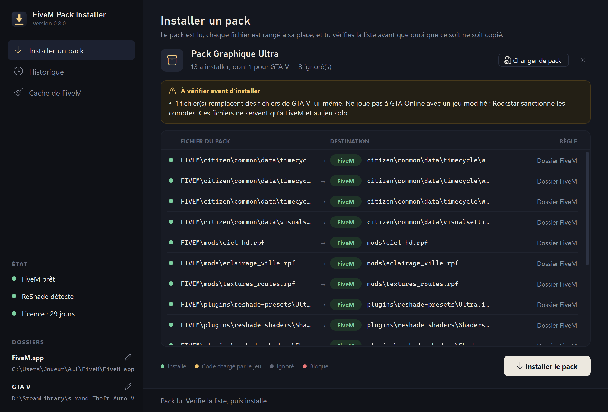
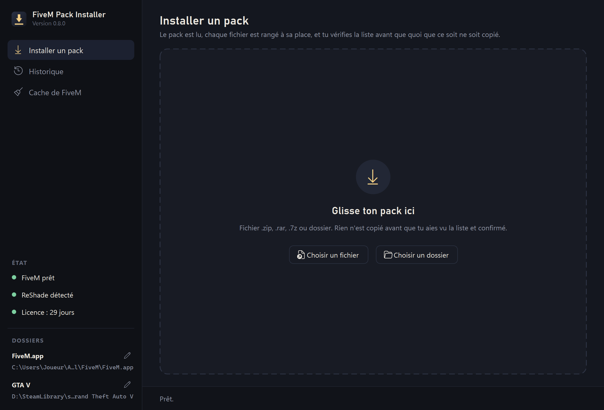
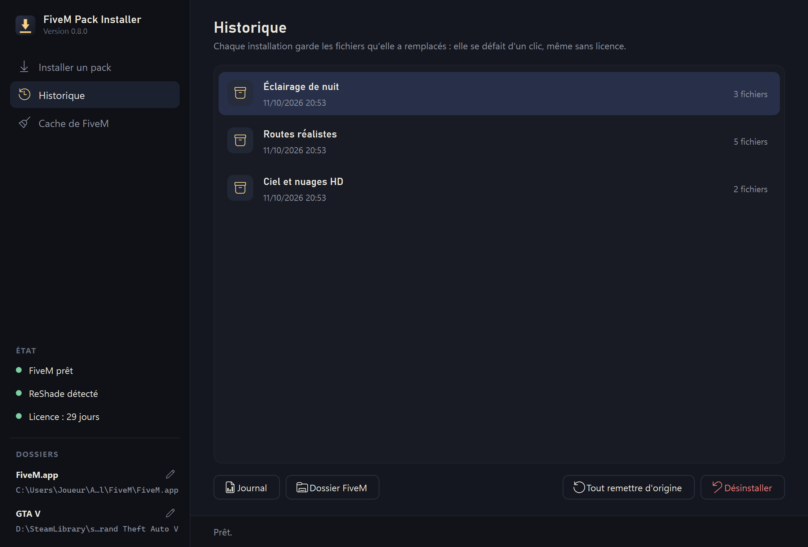
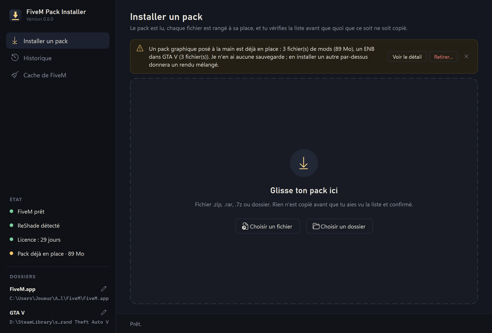
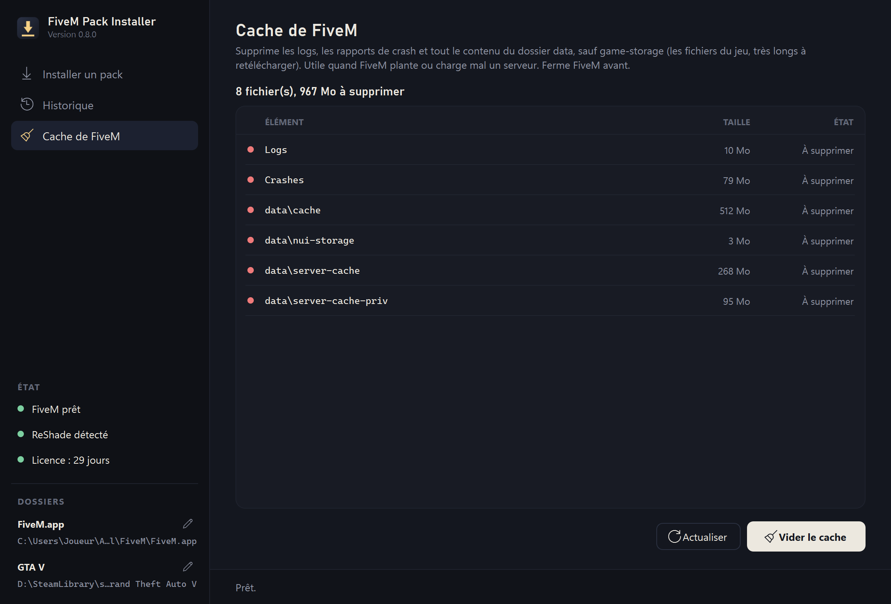
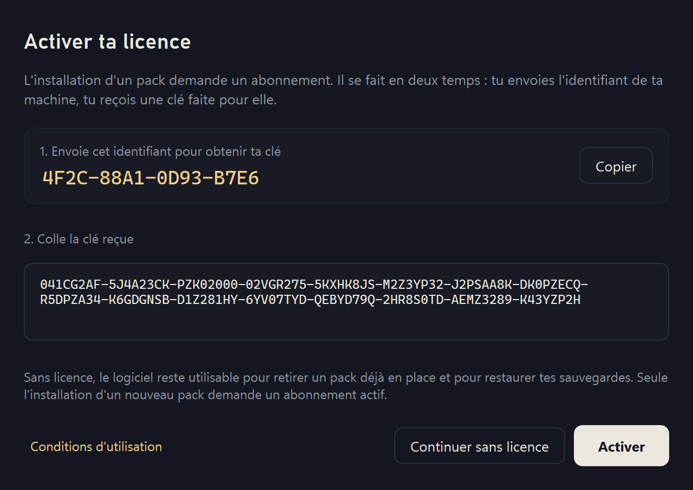

# FiveM Pack Installer

**Installe un pack graphique dans FiveM en le glissant dans une fenêtre — et retire-le d'un clic.**

Le logiciel lit le pack, range chaque fichier à sa place (FiveM ou GTA V), te montre la liste avant de
copier quoi que ce soit, et sauvegarde tous les fichiers qu'il remplace. Ton jeu d'origine n'est
jamais perdu.



## ⬇️ Télécharger

**[Télécharger la dernière version](https://github.com/AestasDev/FiveMPackInstaller-releases/releases/latest)**
— prends le fichier `FiveMPackInstaller-Setup-….exe` dans la section « Assets ».

Windows 10 ou 11 (64 bits) · FiveM installé · environ 32 Mo

## Ce qu'il fait

### Dépose ton pack

Un `.zip`, un `.rar`, un `.7z` ou un dossier : glisse-le dans la fenêtre, ou choisis-le avec les
boutons. Chaque fichier est rangé automatiquement, même quand le pack mélange des dossiers « FIVEM »,
« GTA5 » et des emballages au nom libre. La barre latérale montre d'un coup d'œil l'état de FiveM, de
ReShade et de ta licence.



### Vérifie avant d'installer

Rien n'est copié avant que tu aies vu la liste (image en haut de page) : où va chaque fichier, dans
FiveM ou dans GTA V, et ce qui est ignoré. Tu peux changer une destination d'un clic. Les programmes
(`.exe`, `.bat`, scripts…) sont bloqués, jamais copiés, et les points à surveiller sont signalés
avant l'installation.

### Tout se défait

Chaque installation garde les fichiers qu'elle remplace. Dans l'Historique, **Désinstaller** remet un
pack comme avant ; **Tout remettre d'origine** rend un jeu propre. Ça marche même sans licence.



### Il voit un pack déjà posé à la main

Un pack installé avant le logiciel (mods de FiveM, ENB de GTA V) est repéré : tu vois ce qu'il a
posé, et **Retirer…** le met de côté proprement, avec la possibilité de le remettre en place.



### Vide le cache de FiveM

Logs, rapports de crash et données temporaires : utile quand FiveM plante ou charge mal un serveur.
Les fichiers du jeu (game-storage) ne sont jamais touchés, et tu vois la liste avant de supprimer.



### Et aussi

- **ReShade** : le logiciel vérifie qu'il est installé, et l'installe au besoin depuis le site
  officiel.
- **Toujours à jour** : les nouvelles versions se téléchargent et s'installent toutes seules, et le
  logiciel vérifie qu'elles sont bien signées par l'éditeur avant de les exécuter.

## Installation

1. Télécharge `FiveMPackInstaller-Setup-….exe` (lien ci-dessus).
2. Lance-le. Windows peut afficher **« Windows a protégé votre ordinateur »** : le logiciel n'est pas
   signé numériquement. Clique sur **Informations complémentaires**, puis **Exécuter quand même**.
3. Accepte les [conditions d'utilisation](CONDITIONS-UTILISATION.txt) et suis l'assistant.
4. Le logiciel demande les droits administrateur à chaque lancement : c'est normal, il écrit dans les
   dossiers de FiveM et de GTA V.

**Mises à jour** : une fois installé, le logiciel se met à jour tout seul — il télécharge la nouvelle
version en arrière-plan et l'installe au lancement suivant (ou tout de suite, avec « Installer » dans
sa barre latérale). Tes réglages, ta licence et ton historique sont conservés. Si tu as la 0.7.0,
installe la 0.8.0 une fois à la main : c'est la première version qui se met à jour seule.

## Licence et abonnement

L'installation de packs demande un abonnement. Au premier lancement, la fenêtre d'activation affiche
**l'identifiant de ton ordinateur** (bouton « Copier ») : ta clé est faite pour cet ordinateur-là.

- **Tu as reçu un code d'achat** (`XXXX-XXXX-XXXX-XXXX`) : sur le serveur Discord de la boutique,
  clique sur **Obtenir ma licence** (ou tape `/licence`), puis indique ton code et ton identifiant. Ta
  clé arrive aussitôt, avec une copie en message privé. Tu l'as perdue ? Refais la même demande avec
  le même code : tu retrouves la même clé.
- **Sinon**, envoie ton identifiant à AestasFR par le canal où tu achètes ta licence : tu recevras une
  clé faite pour ta machine.



Colle la clé dans la fenêtre « Activer ta licence », puis clique sur **Activer**. Un renouvellement
commence à la fin de ton abonnement en cours : tu ne perds aucun jour. Tu as réinstallé Windows ou
changé d'ordinateur ? Ton identifiant a changé : contacte AestasFR pour une clé de remplacement.

Même sans licence, ou après la fin de ton abonnement, **tu peux toujours désinstaller tes packs et
restaurer tes fichiers d'origine.**

## Bon à savoir

- Ferme FiveM et GTA V avant d'installer ou de désinstaller un pack.
- Beaucoup de serveurs FiveM interdisent ReShade ou ENB : vérifie leur règlement.
- Ne joue pas à GTA Online avec des fichiers de GTA V modifiés : Rockstar sanctionne les comptes.
- Le logiciel n'envoie aucune donnée personnelle. Il ne se connecte qu'à GitHub, pour chercher ses
  mises à jour, et à reshade.me si tu lui demandes d'installer ReShade.

## Vérifier le fichier téléchargé

Chaque version publie l'empreinte SHA-256 de son installateur dans ses notes de version. Pour la
comparer, dans PowerShell :

```
Get-FileHash .\FiveMPackInstaller-Setup-0.8.0.exe -Algorithm SHA256
```

---

FiveM Pack Installer n'est ni affilié, ni approuvé par Rockstar Games, Take-Two Interactive, Cfx.re
ou l'auteur de ReShade. © 2026 AestasFR — tous droits réservés.
